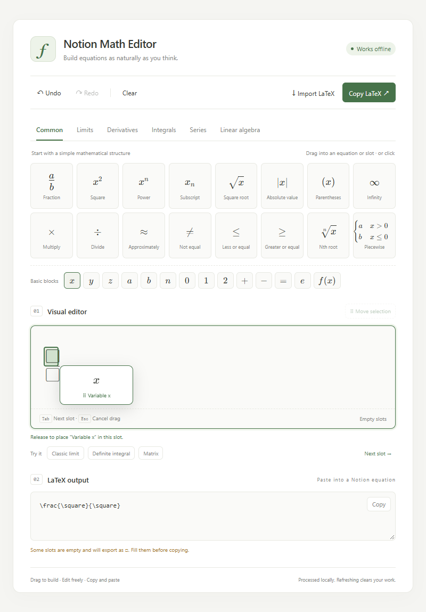

# Notion Math Editor

[English](README.md) · [简体中文](README.zh-CN.md)

An offline visual editor for calculus and linear algebra. Drag mathematical structures into an equation, fill their slots with variables or numbers, and copy common KaTeX-compatible LaTeX into Notion.

## Download and run

Choose one standalone file in [`dist/`](dist/):

- **English:** [`notion-math-editor.en.html`](dist/notion-math-editor.en.html)
- **Simplified Chinese:** [`notion-math-editor.zh-CN.html`](dist/notion-math-editor.zh-CN.html)

Download the file, then open it in a modern browser. No installation, CDN, external fonts, account or network connection is required. `notion-math-editor.html` is a compatibility alias for the Chinese build. The two localized builds share the same editor implementation.

**Real Notion desktop validation is still pending.** Offline browser tests and simulated iframe tests do not certify the behavior of Notion's actual sandbox, upload limits or clipboard permissions.

## Features

- Six categories: common structures, limits, derivatives, integrals, series and linear algebra.
- 56 symbols/templates plus 14 basic variable, number and operator blocks.
- Fractions, powers, subscripts, roots, limits, derivatives, definite and multiple integrals, sums, products, matrices, determinants, vectors and piecewise functions.
- Drag blocks into nested slots. A green marker shows the target before release.
- Select an existing expression and drag the **Move selection** handle to reposition it. A move is one undoable operation.
- Drag a structure over a selection to wrap it; pressing Esc or releasing outside the editor cancels the operation.
- Clicking a symbol inserts at the current cursor or selection. Typing `x` then clicking Square gives `x²`.
- Editable numerators, denominators, bounds, exponents and matrix cells, with keyboard input and Tab/Next slot navigation.
- Undo, redo, clear, explicit LaTeX import and live read-only export.
- Clipboard fallback: source is focused and selected when automatic copying is unavailable. Press Ctrl+C, or ⌘C on Mac.
- Light and dark themes, responsive layouts, and horizontal scrolling for long equations.
- No formula persistence. Copy your work before refreshing or closing the page.

## Build an equation by dragging

1. Drag **Fraction** into the editor.
2. Drag `x` from **Basic blocks** into the numerator slot.
3. Drag **Square** onto the `x` to create `x²`.
4. Drag `1` into the denominator slot.
5. To nest structures, drag a root into a slot, then a variable into the root.
6. To move existing content, select it first, then drag **Move selection** to a green marker. Undo restores the entire move.



## Use inside Notion

1. Create a test page in the Notion desktop app.
2. Type `/html`, choose the HTML embed block and upload the English or Chinese standalone file.
3. Increase the block height so the palette and equation are visible together. About 1200px is useful at narrow widths.
4. Build an equation inside the HTML block, then click **Copy LaTeX**.
5. Create a native Notion equation block, paste the source and confirm the result. Do not add extra `$` delimiters.
6. If automatic copy fails, the editor selects the source. Press Ctrl+C/⌘C manually, then paste into Notion.

The general **Settings → Import → HTML** importer converts documents; it is not the interactive HTML block workflow. If `/html` is unavailable, check your client and workspace's feature availability. To update an uploaded editor, replace its file with the new build.

Dragging is contained within this editor. It does not directly edit Notion's native equation blocks or drag content across the iframe boundary.

## Development

Recommended: Node.js 22.12+ or Node.js 24 LTS, npm 10+.

```sh
npm ci
npm run dev
npm run build
npm run preview
```

The development server defaults to Chinese. Use `npm run dev -- --mode en` for English. Production builds are generated together by `npm run build`. For preview, open `/notion-math-editor.en.html` or `/notion-math-editor.zh-CN.html` on the printed preview URL.

Dependencies are pinned in `package.json` and `package-lock.json`. Use `npm ci` for repeatable installation.

## Tests

```sh
npm test
npm run build
npm run test:e2e
npm run verify:html
```

Vitest checks templates, LaTeX validation, selection wrapping, clipboard fallback and translation coverage. Playwright runs the complete editor/dragging regression suite separately for **both languages**, including all 70 controls, ten acceptance equations, 400/600/800px layouts, light/dark themes, all embedded fonts, clipboard denial and an opaque-origin iframe with restrictive CSP. English UI text and accessibility attributes are checked for untranslated Chinese.

On Windows, tests use an installed Microsoft Edge. In CI, the config uses Playwright Chromium:

```sh
npx playwright install --with-deps chromium
# Set CI=1 in your CI environment, then run npm run test:e2e.
```

Tests run against standalone production files with browser networking disabled. The main regression suite copies each language's HTML into an otherwise empty `work/final-isolated/<language>/` folder before opening it. Local machine-readable reports in `docs/e2e-results.json` are generated by tests and excluded from Git; the shareable summary is [`docs/verification.md`](docs/verification.md).

The original feasibility fixture is available separately:

```sh
npm run build:stage0
npm run test:stage0
```

It outputs `dist-stage0/stage0.html` with a minimal Chinese-language interface. It verifies fraction/integral insertion and offline fonts in a sandbox; it is a development fixture, not the localized application.

## Source layout

```text
src/
  main.ts, styles.css           Application entry and styling
  editor/                      MathLive setup, selections, drag/drop, LaTeX
  components/                  Toolbar, symbol palette, import/export
  data/                        Shared mathematical symbols and templates
  i18n/                        UI translations and language selection
  utils/                       Clipboard fallback
  tests/                       Vitest tests
e2e/                           Shared bilingual browser tests
scripts/                       Feasibility and single-file verification
dist/                          Standalone application builds
```

## Implementation and compatibility

TypeScript + Vite + MathLive, with KaTeX used only to check syntax. The app uses `MathfieldElement.insert()`, `selection`, `getValue()` and `executeCommand()` for structural editing. It never appends to the source string to simulate cursor insertion.

JavaScript, CSS and all 20 MathLive WOFF2 font faces are inlined. Dynamic font loading, audio and the optional compute engine are disabled. The default virtual keyboard is hidden. Inside an iframe, the keyboard controller is initialized in that frame to avoid MathLive 0.111.1's opaque-origin proxy problem; the parent page and sandbox restrictions are not modified.

Imported LaTeX is checked before replacing the equation. Links, HTML commands and custom macros are rejected; input is limited to 10,000 characters. User-provided markup is never inserted with `innerHTML`; palette markup comes only from fixed developer-authored previews.

Unfilled MathLive placeholders export as `\square` with a visible warning. MathLive's `\doubleprime` is normalized to `\prime\prime`. Not all MathLive syntax is supported by Notion; the built-in templates and acceptance formulas have been checked with the bundled KaTeX version.

Known limits:

- Actual Notion CSP, HTML upload behavior and native equation rendering still need manual validation. If the host blocks inline scripts or data-URL fonts, the file cannot override that policy.
- Automatic clipboard access may be denied; manual source copying is supported.
- No refresh persistence, cloud sync, Notion API, browser extension or automatic native-block editing.
- Selection moves support one continuous range. There is no arbitrary two-dimensional layout or cross-iframe dragging.
- Scroll a long formula to its destination before dragging. For short embeds, increase the block height first.
- Windows Edge is tested locally; Safari, Firefox, mobile devices and touch dragging have not been certified.
- MathLive may log a relative-resource-base diagnostic for inline `file:`/`srcdoc` execution. Dynamic assets are disabled; embedded fonts and offline execution are tested independently.

Next priorities are real Notion desktop acceptance, additional browser coverage and matrix-dimension controls.

## References and licenses

- [MathLive API](https://mathlive.io/mathfield/api/)
- [MathLive virtual keyboard](https://mathlive.io/mathlive/guides/virtual-keyboard/)
- [Vite static assets](https://vite.dev/guide/assets)
- [Notion HTML blocks](https://developers.notion.com/reference/block#html-blocks)

The project retains `UNLICENSED` status; no open-source license has been assigned to the project itself. Third-party notices are in `THIRD-PARTY-NOTICES.txt` and embedded in each HTML build.
